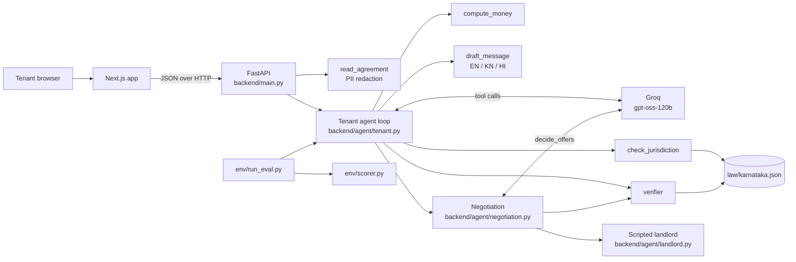

# Dhara AI: Agentic Copilot for Fair Renting

**Which law governs your rental, what each unfair clause costs, and the counter-proposal you approve, before you sign**

English, Kannada and Hindi | Karnataka law pack | Web app

> **ChronoForge 2026, NITK Surathkal** | Track: Agentic AI | Theme: Cities of the Future | Team StrawHats

## The Problem

At the last census, six in ten Bengaluru households rented their home [[R1]](docs/REFERENCES.md#problem-statistics). Their deposits run to several months' rent, held under an 11-month agreement that nobody registers, because a lease over one year must be registered [[R10]](docs/REFERENCES.md#law). At move-out, deductions are argued over WhatsApp.

The law tenants find online is often the wrong law. Posts say deposits are capped at two months; that cap is in the Model Tenancy Act, 2021, which Karnataka has not adopted [[R6]](docs/REFERENCES.md#law) [[R7]](docs/REFERENCES.md#law). The Karnataka Rent Act, amended in January 2026, still sets no deposit limit [[R8]](docs/REFERENCES.md#law), and it does not cover most modern flats at all [[R9]](docs/REFERENCES.md#law). So whatever the agreement says is the rule.

| Metric | Figure |
| --- | --- |
| Bengaluru households that rent | **60.1%** of BBMP households (Census 2011) [[R1]](docs/REFERENCES.md#problem-statistics) |
| Urban renting households in Karnataka | **24,47,718** (Census 2011) [[R2]](docs/REFERENCES.md#problem-statistics) |
| Deposits held by Bengaluru landlords | **₹31,628 crore** (NoBroker study, Jul 2026) [[R3]](docs/REFERENCES.md#problem-statistics) |
| A typical Bengaluru deposit | **6 to 9 months' rent**, ₹3 to 5 lakh for one flat [[R4]](docs/REFERENCES.md#problem-statistics) |
| States that adopted the Model Tenancy Act's approach | **4**, not including Karnataka [[R6]](docs/REFERENCES.md#law) |

## The Solution

Dhara (धारा) is what Indian law calls a section, as in "Dhara 302". Our one rule: **every legal point Dhara makes has to name its section.** The tenant pastes or uploads the agreement and gives three facts (rent, local body, built year), and the agent works in five steps:

1. **Plan:** our code redacts Aadhaar, PAN and phone numbers; the AI reads the clauses and plans what to check.
2. **Ask:** if a fact decides which law applies, such as the building's age, it stops and asks instead of guessing. If the tenant doesn't know either, they can say so, and the result stays unresolved instead of guessed.
3. **Act:** the AI records each unfair clause with the facts it reads from it; our tools decide which law applies and compute the rupees at risk.
4. **Verify:** every legal claim must cite a section that exists, applies in Karnataka and covers this flat; anything else is blocked.
5. **Draft and wait:** a counter-proposal in English, Kannada and Hindi, each clause asking for a specific change with the section it rests on. Nothing goes out until the tenant approves, and approval records a follow-up; Dhara never sends anything itself.
6. **Negotiate within your limits:** as soon as the findings exist, Dhara negotiates two rounds with a scripted landlord (a strict owner or a reasonable broker). Per round the AI makes one call to accept, reject or counter each offer, citing a section for every reject or counter; the verifier checks each section, and code turns any accept past the tenant's own limits (lock-in, refund days, exit painting) into a reject. The tenant approves the agreed terms once, and the letter is rewritten from them, keeping the tenant's ask for any clause still open.

At move-out, the same pattern checks each deduction the landlord claims against the agreement and the dated move-in checklist: the AI records allowed or disputed with the evidence it relied on, code checks the sections, drafts the challenge and gives the next formal step (written demand, legal notice, then the Rent Controller only where the Act applies, otherwise a civil recovery suit; never a police complaint). If the landlord sends one number, such as "painting and repairs 80396", Dhara does not dispute a figure it cannot see: it drafts a request for the itemised list with bills within 7 days (Indian Contract Act s.74: only reasonable compensation is recoverable), and checks each item once the list arrives.


### Core Innovation: the AI reads, code decides

| Part | Who does it | Where |
| --- | --- | --- |
| Read the clauses, decide what to check, extract amounts and conditions | AI (tool calls) | [`backend/agent/tenant.py`](backend/agent/tenant.py) |
| Allowed or disputed for each move-out deduction, with checklist evidence | AI (tool calls) | [`backend/agent/moveout.py`](backend/agent/moveout.py) |
| Next formal step after a refused refund | Code, fixed routes | [`backend/agent/moveout.py`](backend/agent/moveout.py) |
| A lump-sum deduction: ask for the itemised list first | Code | [`backend/agent/moveout.py`](backend/agent/moveout.py) |
| The landlord's offers and concessions | Code, a scripted move table per persona | [`backend/agent/landlord.py`](backend/agent/landlord.py), [`env/tasks/`](env/tasks/) |
| Accept, reject or counter each offer, with a section | AI (one tool call per round) | [`backend/agent/negotiation.py`](backend/agent/negotiation.py) |
| Never settle past the tenant's limits | Code | [`backend/agent/negotiation.py`](backend/agent/negotiation.py) |
| Does the Karnataka Rent Act apply to this flat? | Code | [`backend/tools/law.py`](backend/tools/law.py) |
| Rupees at risk per clause | Code, fixed formulas | [`backend/tools/money.py`](backend/tools/money.py) |
| Is a citation allowed? | Code | [`backend/agent/verifier.py`](backend/agent/verifier.py) |
| Redaction, drafts, approval gate | Code | [`backend/tools/agreement.py`](backend/tools/agreement.py), [`backend/tools/messages.py`](backend/tools/messages.py) |
| Scoring | Code, no model | [`env/scorer.py`](env/scorer.py) |

Each tool result goes back to the AI before its next step, up to 12 tool calls, negotiation included. A bounded rule-based coverage check also catches explicitly priced clauses the model omits, labeling additions in the trace. If the model is unreachable, the same rules provide a fallback and the trace says so.

### The Verifier

| Verdict | When |
| --- | --- |
| **Cited** | The section is in [`law/karnataka.json`](law/karnataka.json), applies in Karnataka and covers this flat |
| **Blocked** | The section is from a law Karnataka has not adopted (the two-month cap), from the Rent Act when the Act does not cover the flat, unknown, or missing from a legal claim |
| **Unverified** | Not a legal claim, shown with that label (for example, Dhara's 10% fairness threshold for rent increases) |

### Measured, not just prompted

The same model reviews each test agreement with and without Dhara's tools and verifier; the deterministic scorer [`env/scorer.py`](env/scorer.py) checks governing law, money within Rs 500, citations and negotiation. Results and limitations: [`env/results/scores.md`](env/results/scores.md). Reproduce with `python -m env.run_eval`.


### Ten-question self-evaluation

Ten questions on model-law confusion, jurisdiction, forfeiture, wear and tear, registration and recovery, answered and self-reviewed with the law pack in view (open-book, not an independent benchmark): [report](env/results/codex_self_eval_report.md), [questions](docs/PUBLIC_CHATBOT_TEST.md).

### Negotiation practice and agreement photos

Open `/negotiate` to practice with a model-driven PG landlord. It responds to the tenant's actual proposals for up to three rounds, checks each response through the citation verifier, allows one correction after blocked claims, and requires approval for each proposal. A live two-turn smoke test passed with Groq `openai/gpt-oss-20b`; the default 120B model was rate-limited. This is a simulation; no message goes to a real landlord. See [the negotiation API and limits](docs/LANDLORD_NEGOTIATION.md).

Open `/scan` to extract a JPEG or PNG agreement photo with Sarvam Vision. Remove personal identifiers from the image first and explicitly agree to remote OCR. The app strips metadata, redacts detected identifiers in extracted text, and asks you to check the wording and amounts before starting a review. Sarvam receives the image and may retain its processing job; Dhara does not control provider retention. See [photo OCR setup and limits](docs/PHOTO_OCR.md).

### Simple, scalable, secure

| | How |
| --- | --- |
| **Simple** | Rules do the work wherever rules are enough: the Rent Act test, the money formulas, the citation check and the scorer are plain Python over one JSON file. The AI only reads the clauses and decides what to check. No database, no queue. |
| **Scalable** | Law is data. Each state is one law pack with a source link per section; the agent, verifier and screens stay the same. |
| **Secure** | Local uploads stay in memory; extracted text is redacted before tenancy-model calls. Optional remote photo OCR requires prior image redaction and consent. Keys come from the environment; outbound drafts require approval. |

## Architecture



### Deliberate Architectural Decisions

| Decision | Choice | Why not the alternative |
| --- | --- | --- |
| **Law** | One JSON law pack with a source link per section | A database or retrieval index adds moving parts; a new state is a new file |
| **Legal decisions** | Plain code for coverage, money and citations | A model can invent a cap or a deadline; code cannot |
| **Model** | Groq `openai/gpt-oss-120b` behind one function, [`backend/llm/provider.py`](backend/llm/provider.py) | Pay per token; the provider can be swapped in one file |
| **State** | In-memory runs keyed by id | No database or queue for a single-user review |
| **Long runs** | The agent runs as a background task; the screen polls and shows the trace filling in | A review takes up to a minute with rate limits |
| **Landlord** | A scripted move table per persona, not a second model | One model call per round, reproducible demos, and the scorer knows which offers were acceptable |
| **Frontend** | Next.js, with a sample mode built from the real tools ([`env/make_frontend_stubs.py`](env/make_frontend_stubs.py)) | The screens work and stay honest before the backend runs |

## Quick Start

### Prerequisites

- Python 3.10+ and Node.js 20+
- A Groq API key

### Configuration

Copy `.env.example` to `.env` and set `GROQ_API_KEY`. Several keys can be given comma-separated; on a rate limit the provider moves to the next one. Never commit real keys; `.env` is ignored by git.

### Backend

```bash
python -m pip install -r backend/requirements.txt
uvicorn backend.main:app --port 8000 --env-file .env
```

### Frontend

```bash
cd frontend
npm install
NEXT_PUBLIC_USE_STUBS=false NEXT_PUBLIC_API_URL=http://localhost:8000 npm run dev
```

Open http://localhost:3000, press **Use the sample agreement**, leave **Year built** blank and press **Review the agreement**. Without the backend, leave out `NEXT_PUBLIC_USE_STUBS=false`: the screens then show a run built from the real tools. More in [frontend/README.md](frontend/README.md).

On Windows, create an environment for Windows rather than reusing a Linux `.venv`:

```powershell
python -m venv .venv-win
.\.venv-win\Scripts\python.exe -m pip install -r backend/requirements.txt -e ".[dev]"
.\.venv-win\Scripts\python.exe -m uvicorn backend.main:app --port 8000 --env-file .env
```

For a plain-model API comparison, use `POST /api/runs?mode=baseline`. Its raw output is explicitly unverified and cannot be approved as a draft. See [baseline API behavior](docs/BASELINE_API.md).

### Tests and evaluation

```bash
python -m pytest -q                                                  # tools, verifier, scorer, agent loop, API
python -m env.scorer env/tasks/blr_flat.json env/tasks/sample_run.json   # 3; the sample run has no negotiation
python -m env.run_eval                                               # plain model vs agent, needs GROQ_API_KEY (EVAL_PAUSE_S spaces runs)
```

Validation on 25 October: **239 tests and 6 subtests passed** in the Windows Python 3.10.11 environment, `pip check` found no broken dependencies, and the frontend production build and ESLint passed. The plan's Python 3.11 environment target has not been independently validated on this Windows checkout. After both negotiation features were merged, **263 tests pass** (Python 3.12, Windows) and the frontend production build is clean.

## Project Structure

```
dhara/
  ├── README.md
  ├── docs/REFERENCES.md        # Sources for every number in this README
  ├── law/karnataka.json        # 25 sourced sections: Karnataka Rent Act, Contract Act, TPA, Registration Act, Model Tenancy Act
  ├── backend/
  │   ├── main.py               # FastAPI: runs, answer, approve; move-out reviews
  │   ├── agent/tenant.py       # Agent loop: tool calls, question, fallback, trace
  │   ├── agent/moveout.py      # Flow 2: itemisation first, deduction verdicts, challenge, next formal step
  │   ├── agent/negotiation.py  # Two rounds: decide_offers, verifier, limits enforced in code
  │   ├── agent/landlord.py     # Scripted landlord: opening and concession per persona
  │   ├── agent/verifier.py     # Citation check
  │   ├── llm/provider.py       # The one model entry point
  │   └── tools/                # law, agreement (redaction), money, messages
  ├── env/
  │   ├── tasks/                # blr_flat, pg_room, moveout (synthetic), with landlord moves
  │   ├── scorer.py             # Governing law, money within Rs 500, citations, negotiation correct, wrong-law penalty
  │   ├── run_eval.py           # Plain model vs agent
  │   └── results/              # scores.md, scores.json
  ├── frontend/                 # Next.js: intake, review report, move-out, evaluation
  ├── tests/                    # pytest
  └── housing/ server/ static/  # The earlier prototype, reused by import
```

## Security & Privacy

- **No locally stored documents:** uploaded agreements are read in memory for the request and never written to disk. Opt-in photo OCR creates a remote Sarvam processing job; provider retention is outside Dhara's control.
- **Redaction first:** Aadhaar, PAN and phone numbers in extracted text are redacted before tenancy-model calls ([`backend/tools/agreement.py`](backend/tools/agreement.py)).
- **Photo privacy:** callers must remove identifiers from image pixels before remote OCR. The checkbox records that declaration; it does not inspect or redact pixels. OCR text is redacted again before tenancy review.
- **No sending:** approval records a follow-up date; Dhara has no delivery integration and never sends a message itself.
- **Keys:** only from environment variables; `.env` is ignored, `.env.example` holds empty placeholders.
- **No personal data in the repo:** team planning notes are kept out of version control.
- **Not a lawyer:** every report carries a not-a-lawyer notice.
- **Verification limits:** citation checks establish source identity and supported applicability rules, not that a model's legal interpretation is correct. The three synthetic evaluation tasks and one clean English OCR image do not establish general accuracy.

## Impact

| SDG | Contribution |
| --- | --- |
| SDG 11 · Sustainable Cities | Fairer rental agreements for the renting majority of a growing city [[R1]](docs/REFERENCES.md#problem-statistics) |
| SDG 16 · Strong Institutions | Advice that cites the law that actually applies, with every step visible |
| SDG 10 · Reduced Inequalities | Kannada drafts and plain-language findings for tenants without legal help |

It scales because law is data: bringing Dhara to another state means sourcing its law pack. The agent, verifier and screens stay the same.

## Credits

- Python dependencies: OpenAI Python SDK, python-dotenv, pytest, pytest-cov, httpx, setuptools and wheel. Event PDF extraction: [pypdf](https://pypdf.readthedocs.io/).
- Law sources: [India Code](https://www.indiacode.nic.in/) and [PRS Legislative Research](https://prsindia.org/billtrack/the-model-tenancy-act-2021). Statistics: see [docs/REFERENCES.md](docs/REFERENCES.md).
- Model: [Groq](https://groq.com/) serving `openai/gpt-oss-120b`, and Whisper (`whisper-large-v3-turbo`) for speech to text. [Sarvam](https://www.sarvam.ai/) is supported as an alternative provider.
- Frontend: [Next.js](https://nextjs.org/), React and [Tailwind CSS](https://tailwindcss.com/) (MIT); [Lucide](https://lucide.dev/) icons (ISC); Geist and Geist Mono (Vercel, OFL-1.1) and Noto Sans Kannada and Noto Sans Devanagari (Google, OFL-1.1) via `next/font`.

## Team

**StrawHats** | ChronoForge 2026, NITK Surathkal
