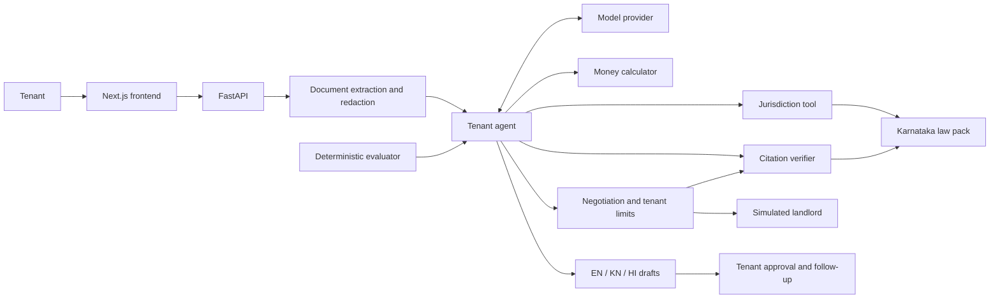

# Dhara AI

**An agentic tenancy copilot for fair renting in Karnataka.**

Review rental terms, understand the money at risk, negotiate within your limits, and challenge deposit deductions with supporting evidence.

English · Kannada · Hindi | Team StrawHats | ChronoForge 2026, NITK Surathkal

Track: Agentic AI · Theme: Cities of the Future

## Problem

Tenants often commit several months of savings as a rental deposit without understanding the clauses that control refunds, lock-in periods, painting charges, notice requirements, and rent increases. At move-out, a single unexplained deduction can become a prolonged dispute.

Finding the right legal information is another challenge. Advice about a model law can be mistaken for an applicable state rule, while important facts about the property remain unknown. A useful tenancy assistant needs to establish jurisdiction, connect its claims to sources, and distinguish legal requirements from negotiating preferences.

## Solution

Dhara turns an agreement and a few property facts into a review the tenant can act on. The model reads clauses and proposes decisions; deterministic tools check jurisdiction, calculate amounts, validate citation identities, and enforce the tenant's negotiating limits.

### Before signing

- Upload a text PDF or paste the agreement, then enter the rental facts.
- Answer missing jurisdiction questions, including the completion month when a building reaches the fifteen-year boundary. An unknown answer leaves the relevant issue unresolved.
- Review clause-level findings, section references, and money-at-risk estimates.
- Follow negotiation rounds with a simulated landlord using strict-owner or reasonable-broker personas. The tenant agent accepts, rejects, or counters offers; code enforces the tenant's limits.
- Generate letters in English, Kannada, or Hindi, approve the outcome, and record a follow-up date. WhatsApp sharing opens a prepared message for the tenant to send.

### At move-out

Check claimed deductions against the agreement and dated move-in evidence. If a landlord sends a lump sum without a usable breakdown, Dhara first prepares an itemisation request. Once individual charges are available, it assesses them, drafts a challenge, and identifies a possible next formal step.

### Additional tools

- **Voice facts:** describe the rental aloud; Groq Whisper transcribes it and the agent proposes form fields for the tenant to check.
- **Photo agreements:** `/scan` uses Sarvam Vision to extract a pre-redacted agreement image, followed by text review.
- **Negotiation practice:** `/negotiate` offers a separate model-driven simulated landlord for practice conversations.
- **Decision trace:** inspect plans, questions, tool results, citation verdicts, negotiation decisions, and approvals.


## Research

### Rental-market evidence

The 2011 Census reported that **60.1% of BBMP households rented their homes**. A housing-market report citing Census data records **24,47,718 urban rented households in Karnataka**. These are historical measures of rental dependence, not estimates of today's market. [Sources and methodology](docs/REFERENCES.md#problem-statistics).

Reports of large deposits and disputed deductions motivated a workflow covering both agreement review and deposit recovery. Company studies and individual news reports are treated as contextual evidence rather than representative estimates of how often tenants lose deposits. [Research references](docs/REFERENCES.md).

### Legal research and product decisions

The [Karnataka law pack](law/karnataka.json) contains section identifiers, paraphrases, applicability notes, and source links covering the Karnataka Rent Act, Indian Contract Act, Transfer of Property Act, and Registration Act. Model Tenancy Act entries are explicitly distinguished from provisions the pack treats as applicable Karnataka law. [Legal sources](docs/REFERENCES.md#law).

This research informs three product choices:

1. **Ask before deciding jurisdiction.** Property age, location, statutory rent, ownership, and exemptions can matter. Current market rent alone does not establish every statutory-rent fact.
2. **Keep preferences separate from law.** Lock-in limits, proposed refund periods, and Dhara's ten-percent rent-escalation threshold are negotiating or product-review choices, not universal statutory caps.
3. **Check evidence before disputing money.** Agreement terms, dated checklists, itemised charges, and supporting records inform the move-out assessment.

## Results

The latest committed evaluation uses Groq `openai/gpt-oss-120b` on three synthetic tasks, dated **25 October 2026**. Pre-signing tasks score jurisdiction, money calculations, citation existence, and negotiation decisions out of **4**. Move-out uses the first three checks and scores out of **3**.

| Task | Dhara score | Observation |
| --- | ---: | --- |
| Bengaluru flat (`blr_flat`) | **3.72 / 4** | Correct jurisdiction; four of five expected findings returned. |
| PG room (`pg_room`) | **3.67 / 4** | Missing building age kept unresolved; one negotiation decision differed from the expected decision. |
| Move-out (`moveout`) | **2.75 / 3** | All expected amounts returned; citation coverage remained incomplete. |

These are single-run results on a small synthetic set, not a general accuracy estimate. The complete methodology, baseline runs, component scores, and artifacts are available in [the evaluation results](env/results/scores.md) and [machine-readable results](env/results/scores.json). No new model run is claimed by this README update.

### Validation

- **263 tests and 6 subtests passed** on the current checkout using Windows Python 3.10.11.
- Frontend TypeScript validation passed after the latest master update.
- A live model-driven landlord smoke test completed two turns with Groq `openai/gpt-oss-20b`. [Evidence and scope](docs/LANDLORD_NEGOTIATION.md).
- A live Sarvam Vision test extracted three clauses from a clean synthetic English image. [OCR validation](docs/PHOTO_OCR.md).
- The [ten-question Codex self-evaluation](env/results/codex_self_eval_report.md) includes generated answers, source links, and a same-assistant review. It is an open-book consistency exercise, not an independent public-product benchmark.

## Architecture



The backend keeps runs in memory. Model access is isolated behind one provider module, legal data lives in a JSON law pack, and the frontend polls for progress. Extending the jurisdiction scope requires sourcing and validating additional law packs.

## Getting Started

### Requirements

- Python 3.10 or newer
- Node.js 20 or newer
- A Groq API key for live model calls and voice input
- A Sarvam API key with Vision access for optional photo OCR

### Configure the environment

Copy `.env.example` to `.env` and fill in the required credentials. Keep real keys out of version control. The default model and provider settings are listed in [.env.example](.env.example).

For the frontend, create `frontend/.env.local`:

```dotenv
NEXT_PUBLIC_API_URL=http://localhost:8000
NEXT_PUBLIC_USE_STUBS=false
```

Set `NEXT_PUBLIC_USE_STUBS=true` to explore the predefined sample reviews without running the backend. Voice, photo OCR, and model-driven practice require their live services.

### Start the backend

From the repository root on Windows:

```powershell
python -m venv .venv-win
.\.venv-win\Scripts\python.exe -m pip install -r backend/requirements.txt -e ".[dev]"
.\.venv-win\Scripts\python.exe -m uvicorn backend.main:app --port 8000 --env-file .env
```

On macOS or Linux:

```bash
python3 -m venv .venv
source .venv/bin/activate
python -m pip install -r backend/requirements.txt -e '.[dev]'
python -m uvicorn backend.main:app --port 8000 --env-file .env
```

### Start the frontend

In a second terminal:

```bash
cd frontend
npm ci
npm run dev
```

Open [the app](http://localhost:3000). For a first walkthrough, select the sample agreement, leave the building year blank, and follow the agent's question, findings, negotiation, and approval flow. [Frontend setup details](frontend/README.md).

## Tests and Evaluation

Run these commands from the repository root with the Python environment active:

```bash
python -m pytest -q
python -m env.scorer env/tasks/blr_flat.json env/tasks/sample_run.json
python -m env.self_eval
```

To run the live evaluation with `.env` loaded:

```bash
python -c "from dotenv import load_dotenv; load_dotenv('.env'); from env.run_eval import main; main()"
```

The live runner spaces requests using `EVAL_PAUSE_S`. Provider failures are recorded separately and do not replace valid score artifacts.

Frontend checks:

```bash
cd frontend
npm run lint
npm run build
```

## Project Structure

```text
backend/       FastAPI, tenant and landlord agents, tools, schemas
frontend/      Next.js intake, review, negotiation, move-out and evaluation screens
law/           Sourced jurisdiction data
env/           Evaluation tasks, scorers, runners and saved results
tests/         Backend and evaluation tests
docs/          Research references, feature guides and screenshots
housing/       Shared housing-review utilities
server/        OpenEnv environment interfaces
```

## Responsible AI and Privacy

- **Decision support:** Dhara is not a lawyer. Important legal decisions need qualified review.
- **Verification scope:** citation checks establish source identity and supported applicability rules; they do not prove that a model's interpretation is correct.
- **Document handling:** uploaded documents remain in local memory during processing. Extracted identifiers such as Aadhaar, PAN, and phone numbers are redacted before tenancy-model calls.
- **Remote processing:** voice input is sent to the transcription provider. Photo OCR requires prior image redaction and explicit consent; provider retention is outside Dhara's control.
- **Tenant control:** negotiation outcomes are simulated. Approval records a follow-up; sharing a letter does not automatically send it to a landlord.
- **Honest evaluation:** synthetic task scores, clean-image OCR tests, and self-authored answers have limited scope. Unknown facts and unverified claims remain visible.

## Credits

- [India Code](https://www.indiacode.nic.in/) and [PRS Legislative Research](https://prsindia.org/) for legal source material; additional research is listed in [References](docs/REFERENCES.md).
- [Groq](https://groq.com/) for model inference and Whisper transcription; [Sarvam](https://www.sarvam.ai/) for optional Vision OCR and alternative model access.
- [OpenEnv](https://github.com/meta-pytorch/OpenEnv) for environment interfaces and evaluation tooling.
- FastAPI, Pydantic, Uvicorn, httpx, pypdf, PyMuPDF, Pillow, and pytest for Python services and document processing.
- Next.js, React, Tailwind CSS, Lucide, Geist, and Noto fonts for the web interface.

## Team

**Team StrawHats** · Hasan and Wasih · ChronoForge 2026, NITK Surathkal
