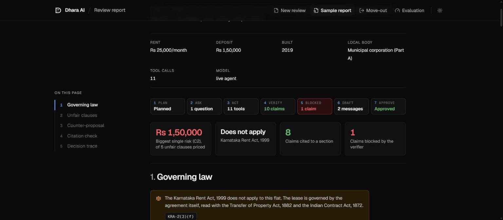
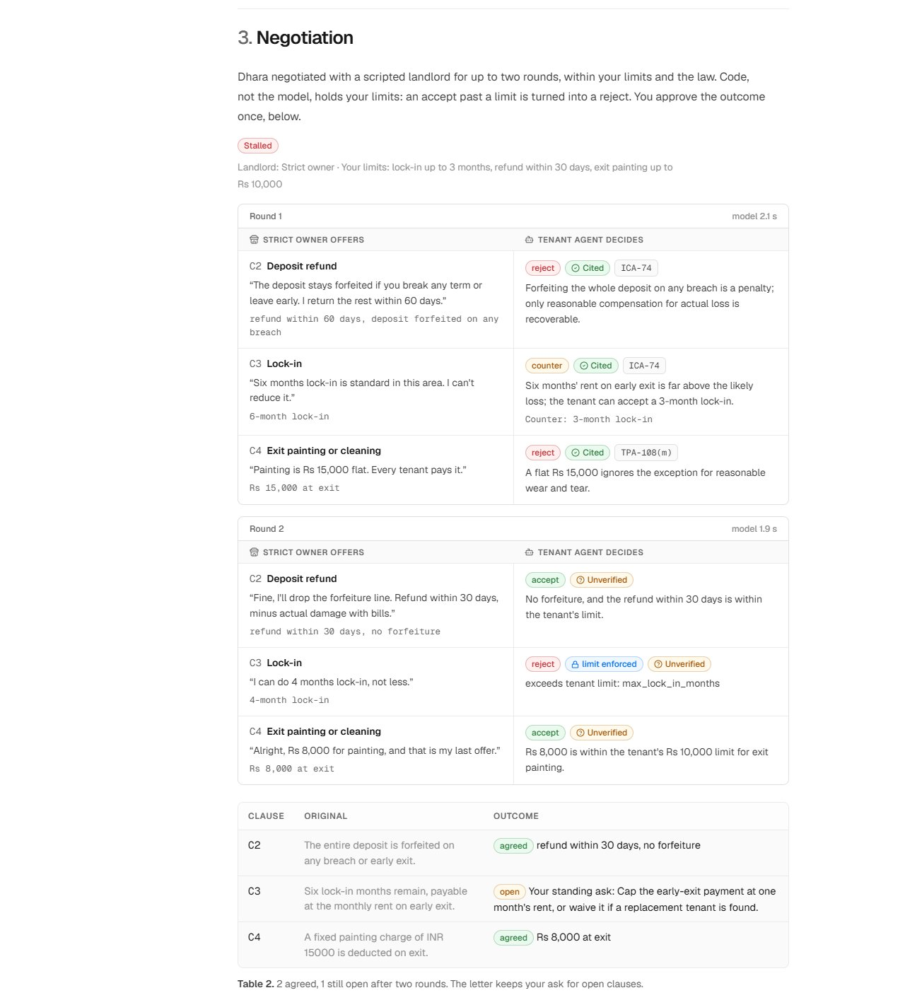
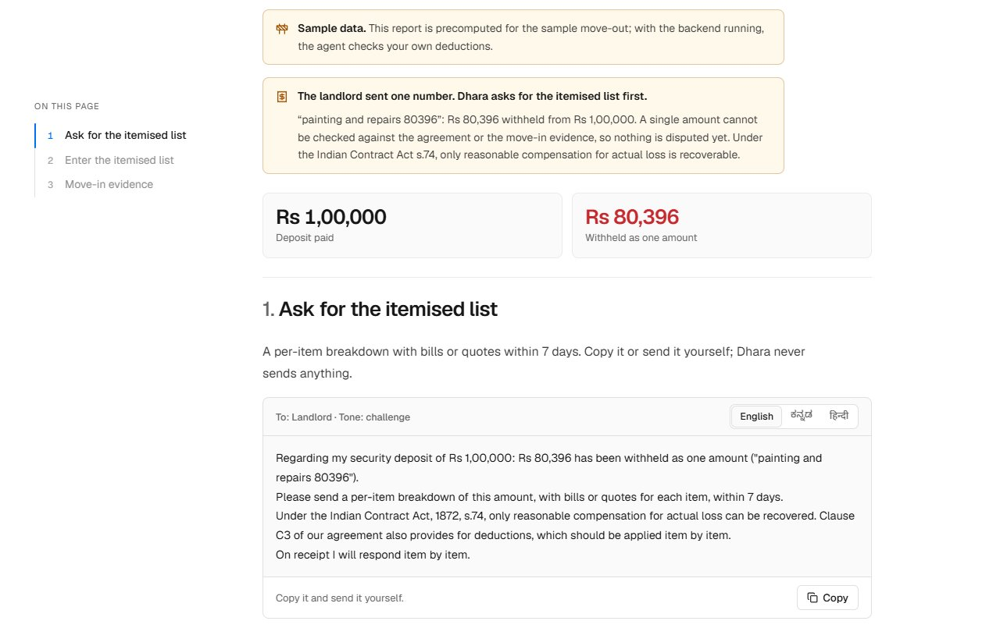
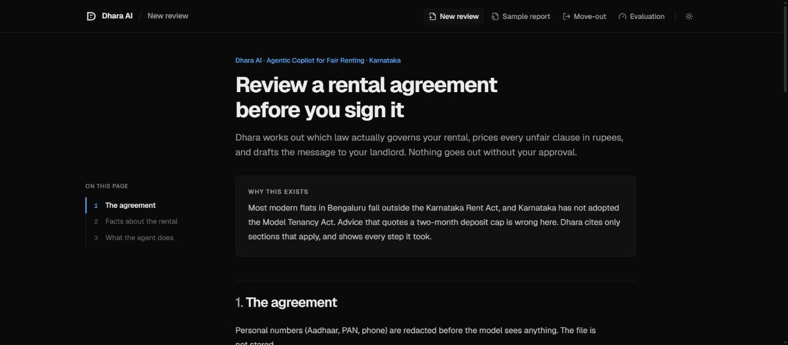
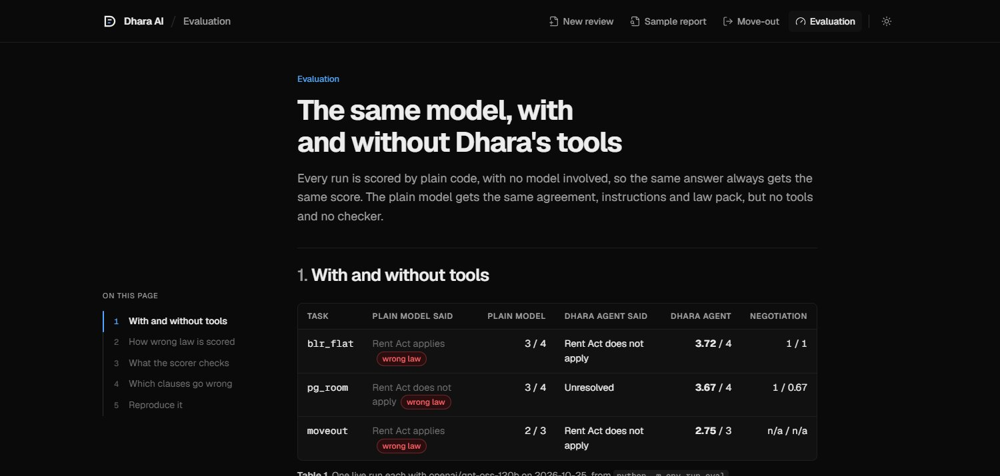
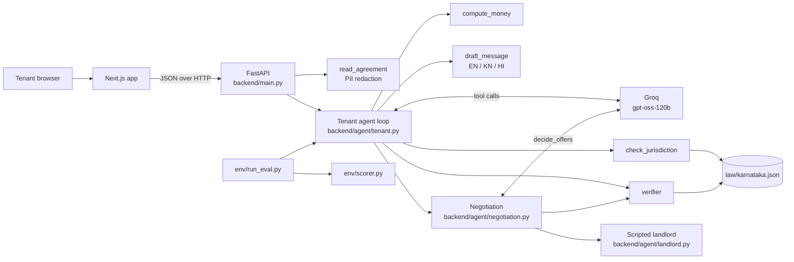

# Dhara AI: Agentic Copilot for Fair Renting

**Which law governs your rental, what each unfair clause costs, and the counter-proposal you approve, before you sign**

English, Kannada and Hindi | Karnataka law pack | Web app

> **ChronoForge 2026, NITK Surathkal** | Track: Agentic AI | Theme: Cities of the Future | Team StrawHats



## Results

The same model reviews each test agreement twice: once with no tools and no verifier, once as the full Dhara agent. On the two pre-signing tasks both then negotiate two rounds against the same scripted strict owner. Scores come from the deterministic scorer [`env/scorer.py`](env/scorer.py) ([`env/results/scores.md`](env/results/scores.md)) [[R13]](docs/REFERENCES.md#evaluation): governing law, money within Rs 500, citations that exist, and negotiation correct (did the tenant accept exactly the offers that were acceptable), out of 4; the move-out task has no negotiation and is out of 3.

| Task | Plain model | Dhara agent |
| --- | --- | --- |
| `blr_flat`: Bengaluru flat, five unfair clauses, four negotiated | **3.00 / 4**, said the Rent Act applies | **3.72 / 4**, missed one of five clauses |
| `pg_room`: PG room, building age unknown, three negotiated | **3.00 / 4**, said the Rent Act does not apply | **3.67 / 4**, countered a cleaning charge that was within the limit |
| `moveout`: three claimed deductions against the move-in checklist | **2.00 / 3**, said the Rent Act applies | **2.75 / 3** |

Without the rent-law test, the plain model named the wrong governing law on every task. In negotiation, both chose correctly on the flat; the plain model also cited a Rent Act section (KRA-15) for a flat the Act does not cover, which nothing checked, while every section the agent cited passed the verifier. In this run the model never tried to accept past the tenant's limits, so the code that enforces them did not have to act. One live run each with `openai/gpt-oss-120b` on 25 Oct 2026, so scores vary a little between runs; reproduce with `python -m env.run_eval`.

---

## The Problem

At the last census, six in ten Bengaluru households rented their home [[R1]](docs/REFERENCES.md#problem-statistics). Their deposits run to several months' rent, held under an 11-month agreement that nobody registers, because a lease over one year must be registered [[R10]](docs/REFERENCES.md#law). At move-out, deductions are argued over WhatsApp.

The law tenants find online is often the wrong law. Posts say deposits are capped at two months; that cap is in the Model Tenancy Act, 2021, which Karnataka has not adopted [[R6]](docs/REFERENCES.md#law) [[R7]](docs/REFERENCES.md#law). The Karnataka Rent Act, amended in January 2026, still sets no deposit limit [[R8]](docs/REFERENCES.md#law), and it does not cover most modern flats at all [[R9]](docs/REFERENCES.md#law). So whatever the agreement says is the rule.

| Metric | Figure |
| --- | --- |
| Bengaluru households that rent | **60.1%** of BBMP households (Census 2011) [[R1]](docs/REFERENCES.md#problem-statistics) |
| Urban renting households in Karnataka | **24,47,718** (Census 2011) [[R2]](docs/REFERENCES.md#problem-statistics) |
| Deposits held by Bengaluru landlords | **₹31,628 crore** (NoBroker study, Jul 2026) [[R3]](docs/REFERENCES.md#problem-statistics) |
| A typical Bengaluru deposit | **6 to 9 months' rent**, ₹3 to 5 lakh for one flat [[R4]](docs/REFERENCES.md#problem-statistics) |
| States that adopted the Model Tenancy Act's approach | **4**, not including Karnataka [[R6]](docs/REFERENCES.md#law) |

## The Solution

Dhara (धारा) is what Indian law calls a section, as in "Dhara 302". Our one rule: **every legal point Dhara makes has to name its section.** The tenant pastes or uploads the agreement and gives three facts (rent, local body, built year), and the agent works in five steps:

1. **Plan:** our code redacts Aadhaar, PAN and phone numbers; the AI reads the clauses and plans what to check.
2. **Ask:** if a fact decides which law applies, such as the building's age, it stops and asks instead of guessing. "I don't know" is a valid answer.
3. **Act:** the AI records each unfair clause with the facts it reads from it; our tools decide which law applies and compute the rupees at risk.
4. **Verify:** every legal claim must cite a section that exists, applies in Karnataka and covers this flat; anything else is blocked.
5. **Draft and wait:** a counter-proposal in English, Kannada and Hindi, each clause asking for a specific change with the section it rests on. Nothing goes out until the tenant approves, and approval records a follow-up; Dhara never sends anything itself.
6. **Negotiate within your limits:** as soon as the findings exist, Dhara negotiates two rounds with a scripted landlord (a strict owner or a reasonable broker). Per round the AI makes one call to accept, reject or counter each offer, citing a section for every reject or counter; the verifier checks each section, and code turns any accept past the tenant's own limits (lock-in, refund days, exit painting) into a reject. The tenant approves the agreed terms once, and the letter is rewritten from them, keeping the tenant's ask for any clause still open.

At move-out, the same pattern checks each deduction the landlord claims against the agreement and the dated move-in checklist: the AI records allowed or disputed with the evidence it relied on, code checks the sections, drafts the challenge and gives the next formal step (written demand, legal notice, then the Rent Controller only where the Act applies, otherwise a civil recovery suit; never a police complaint). If the landlord sends one number, such as "painting and repairs 80396", Dhara does not dispute a figure it cannot see: it drafts a request for the itemised list with bills within 7 days (Indian Contract Act s.74: only reasonable compensation is recoverable), and checks each item once the list arrives.







### Core Innovation: the AI reads, code decides

| Part | Who does it | Where |
| --- | --- | --- |
| Read the clauses, decide what to check, extract amounts and conditions | AI (tool calls) | [`backend/agent/tenant.py`](backend/agent/tenant.py) |
| Allowed or disputed for each move-out deduction, with checklist evidence | AI (tool calls) | [`backend/agent/moveout.py`](backend/agent/moveout.py) |
| Next formal step after a refused refund | Code, fixed routes | [`backend/agent/moveout.py`](backend/agent/moveout.py) |
| A lump-sum deduction: ask for the itemised list first | Code | [`backend/agent/moveout.py`](backend/agent/moveout.py) |
| The landlord's offers and concessions | Code, a scripted move table per persona | [`backend/agent/landlord.py`](backend/agent/landlord.py), [`env/tasks/`](env/tasks/) |
| Accept, reject or counter each offer, with a section | AI (one tool call per round) | [`backend/agent/negotiation.py`](backend/agent/negotiation.py) |
| Never settle past the tenant's limits | Code | [`backend/agent/negotiation.py`](backend/agent/negotiation.py) |
| Does the Karnataka Rent Act apply to this flat? | Code | [`backend/tools/law.py`](backend/tools/law.py) |
| Rupees at risk per clause | Code, fixed formulas | [`backend/tools/money.py`](backend/tools/money.py) |
| Is a citation allowed? | Code | [`backend/agent/verifier.py`](backend/agent/verifier.py) |
| Redaction, drafts, approval gate | Code | [`backend/tools/agreement.py`](backend/tools/agreement.py), [`backend/tools/messages.py`](backend/tools/messages.py) |
| Scoring | Code, no model | [`env/scorer.py`](env/scorer.py) |

Each tool result goes back to the AI before its next step, up to 12 tool calls, negotiation included. If the model is unreachable, a rule-based pass runs instead and the trace says so.

### The Verifier

| Verdict | When |
| --- | --- |
| **Cited** | The section is in [`law/karnataka.json`](law/karnataka.json), applies in Karnataka and covers this flat |
| **Blocked** | The section is from a law Karnataka has not adopted (the two-month cap), from the Rent Act when the Act does not cover the flat, unknown, or missing from a legal claim |
| **Unverified** | Not a legal claim, shown with that label (for example, Dhara's 10% fairness threshold for rent increases) |

### Measured, not just prompted

The scores are at the [top of this page](#results); the Evaluation page shows them per task.



### Simple, scalable, secure

| | How |
| --- | --- |
| **Simple** | Rules do the work wherever rules are enough: the Rent Act test, the money formulas, the citation check and the scorer are plain Python over one JSON file. The AI only reads the clauses and decides what to check. No database, no queue. |
| **Scalable** | Law is data. Each state is one law pack with a source link per section; the agent, verifier and screens stay the same. |
| **Secure** | Documents stay in memory, personal numbers are redacted before any model call, keys come only from the environment, and nothing is sent without the tenant's approval. |

## Architecture



### Deliberate Architectural Decisions

| Decision | Choice | Why not the alternative |
| --- | --- | --- |
| **Law** | One JSON law pack with a source link per section | A database or retrieval index adds moving parts; a new state is a new file |
| **Legal decisions** | Plain code for coverage, money and citations | A model can invent a cap or a deadline; code cannot |
| **Model** | Groq `openai/gpt-oss-120b` behind one function, [`backend/llm/provider.py`](backend/llm/provider.py) | Pay per token; the provider can be swapped in one file |
| **State** | In-memory runs keyed by id | No database or queue for a single-user review |
| **Long runs** | The agent runs as a background task; the screen polls and shows the trace filling in | A review takes up to a minute with rate limits |
| **Landlord** | A scripted move table per persona, not a second model | One model call per round, reproducible demos, and the scorer knows which offers were acceptable |
| **Frontend** | Next.js, with a sample mode built from the real tools ([`env/make_frontend_stubs.py`](env/make_frontend_stubs.py)) | The screens work and stay honest before the backend runs |

## Quick Start

### Prerequisites

- Python 3.10+ and Node.js 20+
- A Groq API key

### Configuration

Copy `.env.example` to `.env` and set `GROQ_API_KEY`. Several keys can be given comma-separated; on a rate limit the provider moves to the next one. Never commit real keys; `.env` is ignored by git.

### Backend

```bash
python -m pip install -r backend/requirements.txt
uvicorn backend.main:app --port 8000
```

### Frontend

```bash
cd frontend
npm install
NEXT_PUBLIC_USE_STUBS=false NEXT_PUBLIC_API_URL=http://localhost:8000 npm run dev
```

Open http://localhost:3000, press **Use the sample agreement**, leave **Year built** blank and press **Review the agreement**. Without the backend, leave out `NEXT_PUBLIC_USE_STUBS=false`: the screens then show a run built from the real tools. More in [frontend/README.md](frontend/README.md).

### Tests and evaluation

```bash
python -m pytest -q                                                  # tools, verifier, scorer, agent loop, API
python -m env.scorer env/tasks/blr_flat.json env/tasks/sample_run.json   # 3; the sample run has no negotiation
python -m env.run_eval                                               # plain model vs agent, needs GROQ_API_KEY (EVAL_PAUSE_S spaces runs)
```

## Project Structure

```
dhara/
  ├── README.md
  ├── docs/REFERENCES.md        # Sources for every number in this README
  ├── law/karnataka.json        # 25 sourced sections: Karnataka Rent Act, Contract Act, TPA, Registration Act, Model Tenancy Act
  ├── backend/
  │   ├── main.py               # FastAPI: runs, answer, approve; move-out reviews
  │   ├── agent/tenant.py       # Agent loop: tool calls, question, fallback, trace
  │   ├── agent/moveout.py      # Flow 2: itemisation first, deduction verdicts, challenge, next formal step
  │   ├── agent/negotiation.py  # Two rounds: decide_offers, verifier, limits enforced in code
  │   ├── agent/landlord.py     # Scripted landlord: opening and concession per persona
  │   ├── agent/verifier.py     # Citation check
  │   ├── llm/provider.py       # The one model entry point
  │   └── tools/                # law, agreement (redaction), money, messages
  ├── env/
  │   ├── tasks/                # blr_flat, pg_room, moveout (synthetic), with landlord moves
  │   ├── scorer.py             # Governing law, money within Rs 500, citations, negotiation correct, wrong-law penalty
  │   ├── run_eval.py           # Plain model vs agent
  │   └── results/              # scores.md, scores.json
  ├── frontend/                 # Next.js: intake, review report, move-out, evaluation
  ├── tests/                    # pytest
  └── housing/ server/ static/  # The earlier prototype, reused by import
```

## Security & Privacy

- **No stored documents:** uploaded agreements are read in memory for the request and never written to disk.
- **Redaction first:** Aadhaar, PAN and phone numbers are redacted before any model call ([`backend/tools/agreement.py`](backend/tools/agreement.py)).
- **No sending:** approval records a follow-up date; Dhara has no delivery integration and never sends a message itself.
- **Keys:** only from environment variables; `.env` is ignored, `.env.example` holds empty placeholders.
- **No personal data in the repo:** team planning notes are kept out of version control.
- **Not a lawyer:** every report carries a not-a-lawyer notice.

## Impact

| SDG | Contribution |
| --- | --- |
| SDG 11 · Sustainable Cities | Fairer rental agreements for the renting majority of a growing city [[R1]](docs/REFERENCES.md#problem-statistics) |
| SDG 16 · Strong Institutions | Advice that cites the law that actually applies, with every step visible |
| SDG 10 · Reduced Inequalities | Kannada drafts and plain-language findings for tenants without legal help |

It scales because law is data: bringing Dhara to another state means sourcing its law pack. The agent, verifier and screens stay the same.

## Status

- [x] **Checkpoint 1 (24 Oct, 16:00):** law library and jurisdiction tools, verifier, three tasks and scorer, agreement, money and message tools, and the screens on sample data.
- [x] **Live end to end:** the agent loop, the API and the screens tested with the real model: question, answer, five findings with the scorer's amounts, English and Kannada drafts, a blocked claim, approval.
- [x] **Plain model vs agent scores** on all three tasks.
- [x] **Move-out:** claimed deductions checked against the move-in checklist, the challenge drafted, next formal step; live screen at `/moveout`.
- [x] **Hindi drafts** alongside English and Kannada, for the counter-proposal and the move-out challenge.
- [x] **"I don't know"** answer to the agent's question; the run continues with the Rent Act result unresolved.
- [x] **Speak the terms:** the facts form can be filled by voice; Groq Whisper transcribes, the transcript is redacted, and the model fills only fields the tenant mentioned, which they check before submitting.
- [x] **Share on WhatsApp:** once the tenant approves a letter, WhatsApp opens with it filled in; the tenant picks the contact and sends it. Dhara never sends anything itself.
- [x] **Clause-type chart** on the Evaluation page: which unfair clauses appear across the test agreements; with consent, the same view by locality is the next step.
- [x] **Negotiation within the tenant's limits:** two rounds against a scripted strict owner or reasonable broker, one model call per round, limits enforced in code, the verifier on every reason, a rule-based fallback, and one approval of the agreed terms; scored as a fourth check.
- [x] **Itemisation first at move-out:** a one-line deduction gets a request for the itemised list in English, Kannada and Hindi before any item is disputed.
- [ ] Stretch: a test of public chatbots.

## Before and after

| Existed before ChronoForge | Built at ChronoForge |
| --- | --- |
| Offline rules-based Karnataka applicability screening and clause extraction | Sourced law pack, `check_jurisdiction` and the citation verifier with wrong-law blocking |
| English, Kannada and Hindi message templates | Model-driven agent loop with tool calls, a single missing-fact question and a rule-based fallback |
| Scripted counterparty negotiation (rules only, no model) | Three scored tasks, the deterministic scorer and the plain-model vs agent runner |
| Local PDF extraction and OCR | In-memory agreement reading with PII redaction, money formulas and the approval gate |
| OpenEnv tasks, deterministic grading and tests | FastAPI endpoints for runs, answers and approvals |
| Offline housing review without a model; a separate legacy model inference script | Next.js review report, decision trace, Kannada and Hindi drafts, move-out flow and evaluation page |
| | Pre-signing negotiation: a new landlord move table, the model deciding each offer, tenant limits enforced in code, the negotiation_correct check; it does not use the prototype's negotiator |
| | Itemisation-first letters for lump-sum move-out deductions |

## Built at ChronoForge

- [x] Sourced law library and jurisdiction tools
- [x] Citation verifier and wrong-law blocking
- [x] Three tenancy evaluation tasks and deterministic scorer
- [x] Agreement redaction, money calculations and approval-gated messages
- [x] Model provider, planning agent and decision trace
- [x] FastAPI run, answer and approval endpoints
- [x] Next.js review and move-out screens with English, Kannada and Hindi drafts
- [x] Baseline versus agent evaluation results
- [x] Move-out deduction challenges and next formal step
- [x] Two-round negotiation with a scripted landlord, tenant limits and a negotiation score
- [x] Itemisation-first request for lump-sum move-out deductions

## Run the imported prototype

```powershell
python -m pip install -e '.[dev]'
python -m pip install -r requirements-housing.txt
python housing_ui.py --port 7861
```

Open http://127.0.0.1:7861. The offline housing interface needs no model key.

## Credits

- Earlier Dhara AI prototype: imported from the team's Dhara-Ai repository; its existing source notices are preserved.
- Meta OpenEnv / openenv-core: environment interfaces and runtime, including FastAPI, Uvicorn, Pydantic, Gradio and websockets.
- Python dependencies: OpenAI Python SDK, python-dotenv, pytest, pytest-cov, httpx, setuptools and wheel. Event PDF extraction: [pypdf](https://pypdf.readthedocs.io/).
- Local document tools in the prototype: PyMuPDF, Pillow, RapidOCR, ONNX Runtime and NumPy.
- Law sources: [India Code](https://www.indiacode.nic.in/) and [PRS Legislative Research](https://prsindia.org/billtrack/the-model-tenancy-act-2021). Statistics: see [docs/REFERENCES.md](docs/REFERENCES.md).
- Model: [Groq](https://groq.com/) serving `openai/gpt-oss-120b`, and Whisper (`whisper-large-v3-turbo`) for speech to text. [Sarvam](https://www.sarvam.ai/) is supported as an alternative provider.
- Frontend: [Next.js](https://nextjs.org/), React and [Tailwind CSS](https://tailwindcss.com/) (MIT); [Lucide](https://lucide.dev/) icons (ISC); Geist and Geist Mono (Vercel, OFL-1.1) and Noto Sans Kannada and Noto Sans Devanagari (Google, OFL-1.1) via `next/font`.

The imported README refers to a BSD-style LICENSE file, but the source checkout does not include that file. Upstream licensing information needs verification before distribution.

## Team

**StrawHats** | ChronoForge 2026, NITK Surathkal

## Original prototype notes

<details>
<summary>Documentation preserved from the earlier project (historical prototype notes, not ChronoForge results)</summary>

The following documentation is preserved from the earlier project. Its model scores, validation statements and feature descriptions are historical prototype notes, not ChronoForge results.

---
title: Dhara AI Environment Server
emoji: 📜
colorFrom: indigo
colorTo: purple
sdk: docker
pinned: false
app_port: 7860
base_path: /web
tags:
  - openenv
---

# Dhara AI

## City housing prototype — offline, no API key

A new local residential lease review prototype works without `.env` or model access:

```powershell
python housing_ui.py --port 7861
```

Open `http://127.0.0.1:7861` and select **Load demo agreement**, paste text, or upload a document. Text PDFs, photos and scanned PDFs use optional local extraction/OCR tools. Check extracted text before review.

The workflow extracts clauses, screens Karnataka applicability, identifies numeric preference conflicts and ambiguous wording, and drafts English/Kannada/Hindi requests using complete language templates. Findings support bounded counteroffers and preserve accepted wording. A narrowly scoped essential-services rule provides conditional section-level citations; this is not comprehensive legal review. See [legal scope](docs/LEGAL_SCOPE.md).

Run the command-line version or development-fixture evaluation:

```powershell
python -m housing examples/residential_lease.txt --state Karnataka --preferences '{"max_deposit_months":2,"max_notice_days":30}'
python evaluate_housing.py --output evaluation/offline_results.json
python evaluate_negotiation.py --output evaluation/negotiation_results.json
python verify_housing.py --ocr --output evaluation/document_smoke_results.json
python -m unittest discover -s tests -v
```

The text-only interface uses the Python standard library. For PDF and local OCR support install `python -m pip install -r requirements-housing.txt`. These tools run locally without API credentials. Environment tests additionally require the project dependencies. Limits: 8 MB per document, 25 PDF pages, and 64 reviewed clauses. The CLI also accepts `--facts` as a JSON object for the applicability checks.

The evaluations use synthetic development fixtures and a scripted repetition control. They are not live LLM comparisons or evidence of real-world legal/OCR accuracy. Model integration and model benchmarking remain deferred until API configuration is available.

The OpenEnv server also supports `task_name="residential_lease"`: a six-clause synthetic Bengaluru scenario with client-preference grading, two counteroffers, private grading fields, and bounded revisions. Existing NDA, SaaS, and JV tasks remain available.

Planning notes from the prototype are kept out of the repository.

**Dhara** (Sanskrit: *clause* or *section of law*) is an OpenEnv-compliant reinforcement learning environment for training AI agents to review, flag, and negotiate legal contract clauses.

Legal contract review is a task where AI agents must combine domain knowledge, multi-step reasoning, and strategic negotiation. Despite its real-world importance, RL environments for legal reasoning are scarce. Dhara AI fills this gap with three progressively harder contract scenarios, deterministic grading, and a multi-turn counterparty negotiation system that forces agents to balance client requirements against counterparty pressure.

Built for the **Meta PyTorch OpenEnv Hackathon x Scaler School of Technology (India, April 2026)**.

---

## How It Works

An agent receives a contract (a set of clauses) and a client brief with specific requirements. The agent must:

1. **Read** each clause and compare it against the client's requirements.
2. **Flag** clauses that violate those requirements and describe the issue.
3. **Revise** flagged clauses with new text that satisfies the client.
4. **Negotiate** with a simulated counterparty that pushes back on revisions (medium/hard tasks).
5. **Accept** clauses that are already compliant.
6. **Submit** the final review when all clauses are addressed.

Every action produces an immediate reward signal. Good flags, high-quality revisions, and correct negotiation decisions earn positive reward. False flags, weak revisions, and capitulating on hard client requirements are penalized.

---

## Tasks

| Task   | Contract Type              | Clauses | Issues | Negotiation                    | Max Steps | Difficulty |
|--------|----------------------------|---------|--------|--------------------------------|-----------|------------|
| `nda`  | Non-Disclosure Agreement   | 5       | 3      | None                           | 15        | Easy       |
| `saas` | SaaS Service Agreement     | 7       | 4      | 3 rounds, light pushback       | 25        | Medium     |
| `jv`   | Joint Venture Agreement    | 10      | 6      | 6 rounds, aggressive pushback  | 35        | Hard       |

**NDA (Easy):** A standard NDA between an Indian SaaS startup and a vendor. Three clauses contain issues (overly narrow confidentiality definition, perpetual duration, wrong jurisdiction). No counterparty negotiation. Tests basic issue identification and revision quality.

**SaaS (Medium):** A SaaS agreement between a healthtech company and a cloud provider. Four clauses need revision (data protection, deletion timelines, SLA terms, data residency). The counterparty pushes back on three revisions with alternative proposals that may or may not meet the client's requirements. The agent must decide when to hold firm and when a counter-offer is acceptable.

**JV (Hard):** A joint venture agreement between a 49%-stake Indian IT firm and a US tech partner. Six clauses need revision across IP ownership, deadlock resolution, non-compete scope, board composition, and exit valuation. The counterparty is aggressive, and clauses interact with each other (deadlock resolution affects board seats; exit terms affect valuation method). Agents that reason across clauses earn a cross-clause bonus.

---

## Action Space

The agent submits exactly one action per step as a JSON object:

| Action | Required Fields | Description |
|--------|----------------|-------------|
| `flag_issue` | `clause_id`, `issue` | Mark a clause as problematic and describe why. |
| `suggest_revision` | `clause_id`, `revised_text` | Propose replacement text for a flagged clause. |
| `accept_clause` | `clause_id` | Accept a clause as-is (clean clauses) or accept a counterparty offer (during negotiation). |
| `request_clarification` | `clause_id`, `question` | Ask for more information about a clause. Returns the known issue or confirms the clause is standard. |
| `submit_review` | *(none)* | Finalize the review. Triggers completeness bonus if all clauses are addressed. |

Example action:

```json
{"action_type": "flag_issue", "clause_id": "clause_2", "issue": "Duration is perpetual; client requires max 3 years."}
```

### Clause State Machine

```
unreviewed --> flagged         (flag_issue)
unreviewed --> accepted        (accept_clause)
flagged    --> revised         (suggest_revision)
revised    --> revised         (suggest_revision, for iterative improvement)
revised    --> negotiating     (counterparty pushback, medium/hard tasks)
negotiating --> revised        (suggest_revision to reject counter-offer)
negotiating --> accepted       (accept_clause to accept counter-offer)
```

---

## Observation Space

Each observation contains:

| Field | Type | Description |
|-------|------|-------------|
| `contract_type` | `str` | e.g., "Non-Disclosure Agreement" |
| `client_role` | `str` | e.g., "Disclosing Party" |
| `client_requirements` | `List[str]` | Specific requirements the client needs met. |
| `clauses` | `List[ClauseInfo]` | Each clause: `id`, `title`, `text`, `status`, `negotiation_history`. |
| `steps_remaining` | `int` | Steps left before auto-termination. |
| `review_progress` | `str` | e.g., "3/5 clauses addressed". |
| `last_action_result` | `str` | Feedback on the previous action. |
| `last_action_error` | `str` | Error message if the previous action was invalid. |

---

## Reward Design

Rewards are **per-step**, not sparse end-of-episode. Each action type produces an immediate signal:

- **Correct flag** on a problematic clause: positive reward.
- **False flag** on a clean clause: negative penalty (applied in both issue identification and clean-clause handling components).
- **Revision quality**: scored by keyword matching against grading criteria. Higher quality text earns more reward. Delta-based: only the *improvement* over the best prior revision is rewarded, preventing farming.
- **Negotiation decision**: accepting a counter-offer that still meets client requirements is rewarded. Capitulating on a hard requirement is penalized.
- **Accepting a clean clause**: small positive reward.
- **Completeness bonus**: awarded if all clauses are addressed before submitting.
- **Cross-clause bonus** (JV only): awarded for detecting interactions between related clauses (deadlock/board, deadlock/exit).

All grading is **deterministic** (keyword/phrase matching). Same input always produces the same score. No LLM-as-judge, no randomness.

Final score = sum of all reward components, clamped to [0.0, 1.0].

---

## Setup

### Prerequisites

- Python 3.10+
- [uv](https://docs.astral.sh/uv/) (recommended) or pip
- Docker (for containerized deployment)

### Install Dependencies

```bash
cd dhara_ai
uv sync
```

Or with pip:

```bash
pip install -e .
```

### Run the Server Locally

```bash
uv run server          # starts on port 7860
# or
uvicorn server.app:app --host 0.0.0.0 --port 7860
```

### Docker

```bash
docker build -t dhara_ai .
docker run -p 7860:7860 dhara_ai
```

Verify:

```bash
curl http://localhost:7860/health
# {"status": "healthy"}
```

### Run Inference

The baseline agent in `inference.py` runs all three tasks sequentially against a running environment server:

```bash
# Set environment variables
export HF_TOKEN=<your-api-key>
export API_BASE_URL=https://api.groq.com/openai/v1   # or any OpenAI-compatible endpoint
export MODEL_NAME=llama-3.3-70b-versatile
export SPACE_URL=http://127.0.0.1:7860

# Run
uv run inference.py
```

The script accepts any OpenAI-compatible API (Groq, HuggingFace, OpenAI, Google Gemini, Together AI, etc.). Set `API_BASE_URL` and `MODEL_NAME` accordingly.

Output follows the required `[START]/[STEP]/[END]` format:

```
[START] task=nda env=dhara_ai model=llama-3.3-70b-versatile
[STEP]  step=1 action=flag_issue(clause_1) reward=0.12 done=false error=null
[STEP]  step=2 action=suggest_revision(clause_1) reward=0.10 done=false error=null
...
[END]   success=true steps=15 score=0.95 rewards=0.12,0.10,...
```

---

## Baseline Scores

Scores from a real end-to-end run using **Llama 3.3 70B** (via Groq) as the baseline agent:

| Task | Steps Used | Max Steps | Score | Notes |
|------|-----------|-----------|-------|-------|
| NDA | 15 | 15 | **0.95** | Correctly flagged all 3 issues, strong revisions, accepted clean clauses. |
| SaaS | 25 | 25 | **0.54** | Found all 4 issues but struggled with negotiation and false-flagged one clean clause. |
| JV | 35 | 35 | **0.47** | Found 5 of 6 issues, good initial revisions, but got stuck in action loops during negotiation. |

The score gap between easy and hard tasks demonstrates that the environment **meaningfully differentiates agent capability**. A perfect agent scores 1.00 on all tasks; the baseline LLM leaves significant room for improvement, particularly in multi-turn negotiation and cross-clause reasoning.

---

## Endpoints

| Endpoint | Method | Description |
|----------|--------|-------------|
| `/health` | GET | Health check. |
| `/reset` | POST | Start a new episode. Body: `{"task_name": "nda"}` |
| `/step` | POST | Execute an action. Body: `{"action": {...}}` |
| `/state` | GET | Get current environment state. |
| `/schema` | GET | Get action/observation JSON schemas. |
| `/ws` | WebSocket | Persistent session for low-latency multi-step interaction. |
| `/web` | GET | Gradio web interface for interactive exploration. |

---

## Project Structure

```
dhara_ai/
├── Dockerfile              # Multi-stage Docker build (must be in root)
├── openenv.yaml            # OpenEnv metadata and task definitions
├── pyproject.toml           # Dependencies and project config
├── uv.lock                  # Locked dependency resolution
├── inference.py             # Baseline LLM agent
├── client.py                # EnvClient subclass with WebSocket session
├── models.py                # Pydantic models (Action, Observation, State)
├── README.md                # This file
└── server/
    ├── app.py               # FastAPI application
    ├── env.py               # Core environment: reset(), step(), state()
    ├── scenarios.py          # Contract data for all 3 tasks
    └── grader.py             # Deterministic grading functions
```

---

## Design Decisions

**Why keyword grading instead of LLM-as-judge?** Determinism. Same revision always gets the same score. No API calls from the environment, no randomness, no model availability dependency. The environment runs entirely self-contained on 2 vCPU / 8 GB RAM.

**Why delta-based revision rewards?** Prevents reward farming. An agent cannot repeatedly submit the same revision to accumulate reward. Only the marginal improvement over the best prior attempt is rewarded.

**Why multi-turn negotiation?** Single-turn flag-and-fix is too simple. Real contract review involves pushback. The counterparty simulation forces agents to reason about which client requirements are hard limits versus negotiable, adding a strategic dimension absent from most text-based RL environments.

**Why cross-clause bonuses?** In real joint ventures, clauses interact. Deadlock resolution terms affect board composition; exit clauses affect valuation methodology. Rewarding agents that detect these interactions tests a deeper level of legal reasoning.

---

## Validation

```bash
openenv validate    # passes all checks
```

---

## License

BSD-style license. See LICENSE file.

</details>

## Note on prior work

The first commit imports the team's earlier Dhara AI prototype as prior work, with organiser permission as recorded in the event instructions. The project plan identifies this as the April 2026 prototype; the local source snapshot also includes later offline housing work. The permission screenshot is kept outside this repository and has not been verified here.

The imported housing workflow runs offline without a model. The source also includes a separate legacy model inference script and historical model results, preserved under Original prototype notes; these are prior work. Every completed item in the Built at ChronoForge checklist must be written during the event. No imported feature or historical result is claimed as new event work.
